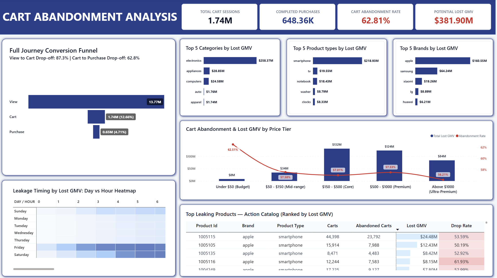

# Cart_Abandonment_Analysis

> **An end-to-end data analytics project that cleans and analyzes 67.4M clickstream events to diagnose critical checkout bottlenecks. Built using Python, MySQL, and an interactive Power BI dashboard, it uncovers a 62.81% cart abandonment rate representing $381.90M in lost revenue. The findings deliver targeted, high-ROI product recommendations to eliminate checkout friction, recover high-ticket sales, and optimize conversion flows.**

---

## Dashboard Preview



---

## 1. Executive Summary & Business Question
* **Business Question:** *"Where in the checkout flow are customers dropping off most, and what should the product team fix first?"*
* **Scope:** Analyzed 67.4M cleaned event logs across 13.77M user sessions.
* **Core Finding:** Out of **1.74M cart sessions**, only **648.36K purchases** completed. This results in a **62.81% Cart Abandonment Rate** and **$381.90M in Potential Lost GMV**.

---

## 2. Executive Scorecard

| Metric | Value | Significance |
| :--- | :--- | :--- |
| **Total Cart Sessions** | **1.74M** (1,743,342) | Sessions exhibiting purchase intent |
| **Completed Purchases** | **648.36K** (648,364) | Sessions finalizing orders |
| **Cart Abandonment Rate** | **62.81%** | Core checkout drop-off rate |
| **Potential Lost GMV** | **$381.90M** | Revenue trapped in abandoned carts |
| **Top Leaking Category** | **Electronics ($258.37M)** | 67.6% of total revenue loss |
| **Top Leaking Brand** | **Apple ($160.55M)** | 42.0% of platform lost GMV |
| **Core Value Tier** | **$150 – $500 ($132.00M)** | Largest monetary drop segment |
| **Peak Leakage Windows** | **Fri (02:00–13:00) & Sat (04:00–08:00) & Thursday 18:00** | Leakage timing |

---

## 3. Key Findings: Where Customers Drop Off Most
* **Cart-to-Purchase Bottleneck:** While browsing view-to-cart drop-off is 87.3%, the primary commercial breakdown occurs between Cart and Purchase (62.81% abandonment).
* **Electronics & Smartphones:** **Electronics** accounts for **$258.37M** in lost GMV, with **Smartphones** driving **$218.93M**. **Apple ($160.55M)** and **Samsung ($64.24M)** drive over 58% of platform losses.
* **Mid-to-Premium Exposure:** Carts priced **$150–$1,000** make up **67% of all lost GMV** ($132M in $150–$500 tier; $124M in $500–$1000 tier).
* **Temporal Patterns:** Heatmap analysis by Lost GMV reveals heavy morning drop-offs on **Friday (02:00–13:00)** and **Saturday (04:00–09:00)**, alongside surge on **Thursday at 18:00**.

---

## 4. Product Recommendations: What to Fix First
1. **Reduce High-Ticket Friction (Priority 1):** Integrate **Buy Now, Pay Later (BNPL)** and **0% No-Cost EMI** on cart drawers for items over $150 to reduce sticker shock on Apple and Samsung devices.
2. **Enable 1-Click Express Checkout (Priority 2):** Add express wallets (Apple Pay, Google Pay, UPI) on top leaking SKUs (e.g., Apple SKU `1005115` - $24.48M loss) to eliminate multi-step address forms.
3. **Automate Surge Retargeting (Priority 3):** Trigger recovery notifications within 30–60 minutes for Friday/Saturday drops, and scale payment concurrency to prevent checkout latency during peak promotional spikes.
4. **Upfront Pricing & Trust Badges (Priority 4):** Display warranty seals, transparent return policies, and all-inclusive pricing upfront to resolve hesitation in the $150–$500 price bracket.

---

## 5. Tech Stack & Architecture
* **Python (Pandas):** Cleaned 67.5M records, purged 10 null sessions and 100,519 duplicate clicks, engineered taxonomy fields (`main_category`, `sub_category`, `product_type`), and serialized to Parquet.
* **MySQL:** Ingested 67.4M records into `ecommerce_events` via 100k chunk batches and engineered aggregation CTE tables (`agg_funnel_summary`, `agg_platform_lost_gmv_summary`,`agg_category_brand_funnel`,`agg_price_tier_funnel`, `agg_temporal_abandonment_patterns`, `agg_nov_top_abandoned_products`).
* **Power BI:** Built an executive dashboard with locked macro visual filtering, responsive item-level tooltips, and validated DAX measures.

---

---

## 6. Dataset Access & Reproduction
Due to GitHub file size limits, the raw and processed data files are omitted from direct repository tracking.

- **Raw Source:** [eCommerce behavior data from multi category store]([https://www.kaggle.com/datasets/mkechinov/ecommerce-behavior-data-from-multi-category-store](https://www.kaggle.com/datasets/mkechinov/ecommerce-behavior-data-from-multi-category-store)) (`2019-Nov.csv`)
- **Data Reproduction:** Run `Cart_Abandonment_Analysis.ipynb` locally to execute the cleaning pipeline and generate `2019-Nov-cleaned.parquet`.

## 7. Repository Layout
```plaintext
├── Cart_Abandonment_Analysis.ipynb  # Data audit, cleaning, feature engineering
├── SQL.sql                          # MySQL, indexes, and aggregation CTEs
├── Dashboard.pbix                   # Power BI executive dashboard
├── Dashboard_image.png              # Dashboard image
├── Data_Cleaning_Documentation.docx # Cleaning and ETL audit report
├── Project_Summary.docx             # Executive summary, business insights and recommendations
├── Presentation.pdf
└── README.md
